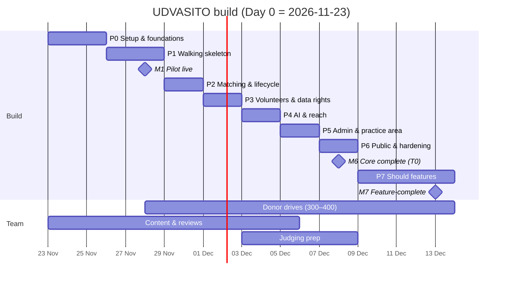

# roadmap.md — UDVASITO (উদ্ভাসিত) Build Roadmap & Issue Check

> **Status:** ✅ APPROVED v1.1 — Step 7 of 8 (SpecPilot). v1.0 approved with decisions D-R1–D-R5 as recommended; v1.1 applies the team rule **"show judges a functional platform, not a demo"** (§1.1).
> **Last updated:** 2026-11-23 (Day 0)
> **Depends on:** `vision.md` v1.4, `user-stories.md` v1.3, `grilling-notes.md` v1.1, `PRD.md` v1.3, `ADRs.md` v1.2, `specs.md` v1.2 (all APPROVED).
> **Rule for the AI coding agent:** build the phases **in order**. A phase starts only when the previous phase meets its Definition of Done and is deployed to staging. Each phase says what is **in** and what is **out**; anything out is not built "while you're there" — write it in `docs/later.md` instead. If this file and `specs.md` disagree about **what** to build, `specs.md` wins; about **when**, this file wins. All decisions in §8 are made. `specs.md` §1.9 (real platform, never a mock-up) applies to every phase.

## Contents
1. Plan at a glance
2. How every phase runs (build loop, Definition of Done, native-build budget, environments, live-data rules, pilot operations)
3. Phases P0–P7
4. Team workstreams (members 2–5) and deliverables
5. Content and data contracts (file formats the code expects)
6. One-time setup runbooks
7. Issue check (contradictions, missing specs, wrong ordering, underestimated risks, scope creep)
8. Decisions (D-R1–D-R5, all accepted)
9. Cut list and protected core
10. Effects on earlier documents
11. Hand-off to Step 8
12. Change log

---

## 1. Plan at a glance

**Window:** Day 0 = Mon 2026-11-23 → Day 20 = Sun 2026-12-13. **T0 = Day 15, Tue 2026-12-08: every core (Must) feature live and working — public launch.** **Day 20, Sun 2026-12-13: every "if time" (Should) feature working.** There is no fixed organiser date, so from Day 15 the live platform must be ready to show judges every evening.

| Phase | Days | Dates | Goal | Ends with |
|---|---|---|---|---|
| **P0** Setup & foundations | 0–2 | Mon 23 – Wed 25 Nov | Accounts, repo, full schema, sign-in, languages, every native module, seeds, CI, deploys | **M0 "Hello, staging"** — sign in on the Android dev build and in Chrome, empty Home in EN/BN |
| **P1** Walking skeleton | 3–5 | Thu 26 – Sat 28 Nov | The whole loop, thin but real and safe: consent → sign-in → donor sign-up with Telegram or in-person verification → form request → wave 1 → push → accept → mutual reveal → close | **M1 Pilot v0.1 live (Sat 28 Nov)** — donor sign-up opens at the first campus drive |
| **P2** Matching & lifecycle | 6–7 | Sun 29 – Mon 30 Nov | Full rules: ranking, waves 2–3, compatible groups in the last wave, still-coming checks, standby, auto-close, confirmation, cooldown, availability, report & block | **M2 "Rules complete"** — request posting is promoted publicly |
| **P3** Volunteers & data rights | 8–9 | Tue 1 – Wed 2 Dec | Volunteer apply/approve, on-duty hotline in 30 s, board, claim, escalation, donor search without numbers, my-data screen | **M3 "A human within 30 seconds"** |
| **P4** AI & reach | 10–11 | Thu 3 – Fri 4 Dec | Redaction + rules parser + Gemini intake, voice, web push, alert guide, offline outbox, Bangla polish | **M4 "Speak it, paste it"** |
| **P5** Admin & practice area | 12–13 | Sat 5 – Sun 6 Dec | Dashboard, moderation, audit viewer, AI controls, usage monitor, practice area, read-only settings | **M5 "Practice area works"** — PRD §2.3 passes on staging |
| **P6** Public pages & hardening | 14–15 | Mon 7 – Tue 8 Dec | Landing, About, final legal pages, accessibility, performance, security, Playwright smoke, release APK, rehearsals | **M6 Core complete = T0 (Tue 8 Dec)** — public launch; judges can be shown the live platform |
| **P7** Should features | 16–20 | Wed 9 – Sun 13 Dec | Pilot bug fixes, then **all 23 Should stories** in priority order, each switched on only when it fully works | **M7 Feature-complete (Sun 13 Dec)** |
| Later | after Day 20 | — | Nice-to-have stories, F1–F3 (community funding, partner donors, hospital staff), WhatsApp verification, Play Store | — |



**Load check:** 40 Must stories across 13 build days (P1–P6) ≈ 3 stories a day for one developer with Claude Code. That only works if (a) everything hard to change is decided in P0, (b) the team does all non-code work (§4), and (c) the cut list (§9) is used early rather than late.

### 1.1 Team rule: judges see a functional platform, not a demo (vision principle 10, D12)
- **What judges see is the live production system** with real pilot data: real donors, real requests and outcomes, real volunteers, real dashboards (PRD §2.3 part 1). Nothing is staged, seeded or invented in production.
- **Hands-on testing happens in the practice area** (PRD §2.3 part 2) — the same live system, with real push, real AI, real Telegram and real calls, whose alerts reach only practice accounts on real phones. It exists only so a judge's test request never wakes up to 85 real donors (waves of 10 + 25 + 50).
- **Every visible control works.** No mock screens, sample data, "coming soon" labels or dead buttons in any phase. A feature that isn't finished has no entry point anywhere (`settings.features` switch off).
- **"Everything" means all 40 Must stories by Day 15 and all 23 Should stories by Day 20.** Nice-to-have and Later items (community funding, partner donors, hospital staff accounts, WhatsApp verification, Play Store) stay after the competition, as approved in the PRD.
- **If the organisers set a judging date before Day 20,** the platform is shown with every finished feature switched on; unfinished ones stay hidden — never shown half-working.

---

## 2. How every phase runs

### 2.1 The build loop (developer + Claude Code)
1. Start a **fresh Claude Code session** in the repo and paste the phase prompt from Step 8. Each prompt is self-contained; the seven documents live in `/docs` and `CLAUDE.md` tells the agent to read them.
2. The agent first writes a **short plan** (files, functions, tests, open questions) — you approve or correct it before any code is written.
3. Build in **vertical slices**: Convex function + tests → screen → EN/BN strings → wire-up. Commit after each slice (`P1: requests.create with idempotency + tests`).
4. `npm run check` (type check, lint, i18n lint, Vitest, convex-test) must be green before every push.
5. Push to `staging` → Cloudflare staging (`staging.udvasito.com`) + Convex staging deploy automatically.
6. Member 3 runs the QA checklist items for the phase (`specs.md` §7.9) on two Android phones and one browser the same evening. Bugs become GitHub issues labelled `P<n>` and `sev1` (blocks the loop) / `sev2` / `sev3`.
7. Fix `sev1`/`sev2`, then merge `staging` → `main` → production (web + Convex). JavaScript changes reach installed apps by **EAS Update**; a new APK only when the native layer changes (§2.3).
8. Update the status column in §3 of this file and `CHANGELOG.md`.

### 2.2 Daily rhythm
| Time | What |
|---|---|
| 09:00 | 15-minute stand-up in the team WhatsApp group: yesterday · today · blocked |
| 09:30–13:30 | Developer deep work 1 — heaviest generation with Claude Code |
| 14:30–18:00 | Developer deep work 2 — finish slices, tests, deploy to staging by 18:00 |
| 18:00–21:00 | Member 3 tests staging; members 2/4 report drive and moderation numbers |
| 21:00 | Developer triages bugs for tomorrow, then stops coding. Never start a new phase at night |

**Claude Code usage limits:** the Max plan has rolling usage windows. Put the big generation tasks in the morning; when a limit is reached, switch to manual work (device testing, account setup, reviewing diffs, writing issues) rather than waiting.

### 2.3 Definition of Done — applies to every phase (each phase adds its own)
- CI green: `tsc --noEmit`, ESLint (including `i18next/no-literal-string`), Vitest, convex-test.
- Every new string exists in `en.json` **and** `bn.json`; member 3 reviews new Bangla within 24 hours.
- Every new public Convex function uses the `convex/_lib/auth.ts` wrappers and has at least one **access test** (wrong role or wrong owner → `ERR_FORBIDDEN` / `ERR_NOT_FOUND`).
- Every query uses an **index** (no full-table `.filter()` scans) — the free plan depends on it.
- Every row that can belong to the practice area carries `isDemo`, and a test proves real and practice data never meet.
- **No phone number** in logs, events, Sentry, push text or AI input.
- Every screen built in the phase has its loading, empty, error and offline states from `specs.md`.
- **No placeholder, mock data or dead control** reaches production; links to screens of later phases stay hidden until those screens work (`specs.md` §1.9).
- Rule numbers come from the `settings` table — never typed into logic.
- Deployed to staging and tried on the 2 GB Android phone and in Chrome.

### 2.4 Native build budget (EAS free plan: 15 Android builds a month)
Check on expo.dev **on Day 0** when the monthly build quota resets for this account, and write the date here: `____`.

| # | Day | Build | Profile | Why |
|---|---|---|---|---|
| 1 | 1 | Development build (dev client) | `development` | All native modules, permissions and the notification channel are configured in P0 |
| 2 | 2 | Reserve | — | Fix a native config mistake from build 1 |
| 3 | 5 | **Pilot APK v0.1.0** | `production` | First public APK → GitHub Release → `/download`. **The final app icon must be in before this build** |
| 4 | 11 | Only if P4 changed the native layer | `production` | Otherwise P4 ships by EAS Update |
| 5 | 15 | **Release APK v1.0.0** | `production` | Judging and public launch |
| 6 | 17–20 | Pin map (if reached in P7) | `production` | Adds MapLibre (D-R2) |
| 7–10 | — | Reserve | — | Emergencies |

Rules: changing `app.config.ts` plugins, a native module, permissions, the icon/splash or the package name = new build. Everything else = EAS Update (the `fingerprint` runtime policy in `specs.md` §1.2.1 guarantees an update never reaches an incompatible APK). **Fallback** when the free queue is slower than 60 minutes or the quota is gone: the manual GitHub Actions workflow "Android local build" runs `eas build --local` on GitHub's Ubuntu runner (free for public repositories) and attaches the APK to a draft release. Expo Go cannot receive remote push on Android, so the development build is needed from Day 1.

### 2.5 Environments, branches, data
| Environment | Convex | Web | App | Data |
|---|---|---|---|---|
| Staging | `udvasito-staging` (EU) | `staging.udvasito.com` (`staging` branch) + previews for feature branches | Development build; `preview` APKs for testers | Fake data from `scripts/seed-staging.ts`; staging-only password sign-in for automated tests (P-10) |
| Production | `udvasito-prod` (EU) | `udvasito.com` (`main`) | `production` APKs | Real users from Day 5, plus the isolated practice area (F-912) |

### 2.6 Rules once real people use production (from Day 5)
1. **Schema changes are additive only.** New fields are `v.optional(...)`, backfilled by an internal mutation in batches, and made required only after every row has a value (widen → migrate → narrow). Never delete or rename a field holding live data in the same deploy.
2. **No hand edits** of live rows in the Convex dashboard — use `internal.admin.ops.*` from the CLI (audit-logged) until the admin screens exist.
3. **Smoke-test production inside the practice area** (accounts flagged `isDemo` with `internal.admin.ops.setDemo`), never with real requests.
4. **Seed scripts never run against production** except `seed-places`, `seed-settings` and `import-hospitals`, which are idempotent.

### 2.7 Pilot operations (Day 5 onwards)
| Duty | Who | How |
|---|---|---|
| Helpline / fallback phone (24/7) | Developer (super-admin) | `settings.fallbackContactPhone`; phone on loud at night |
| Reports and freezes until the moderation queue exists (P5) | Member 4, twice a day + on any "asked for money" report | Convex dashboard (read-only) for `reports`; actions through `internal.admin.ops.setStatus` run by the developer |
| Errors | Developer | Sentry email alerts to the team account |
| Free-tier usage until the usage monitor exists (P5) | Developer, daily | Convex, Cloudflare, Expo, AI Studio, Cloudinary dashboards |
| Backups | Automatic | Daily export cron (NFR-03), checked once on Day 6 |
| Personal-data incident | Member 4 leads | One-page breach plan (DEP-02c): contain → assess → inform affected people → record |

---

## 3. Phases

Status column (update as you go): ⬜ not started · 🟦 in progress · ✅ done (date).

### P0 — Setup and foundations · Day 0–2 · Mon 23 – Wed 25 Nov · 🟦 (started 2026-11-27)
**Goal:** a real but empty app — sign in with Google on the Android development build and on the web, see an empty Home in English and Bangla, served from staging and production. Everything that is expensive to change later is settled now.

**Day plan**
| Day | Work |
|---|---|
| 0 (Mon) | Accounts and services (RB-1 to RB-9, §6) — no card on any account. Public repo with MIT licence, `/docs` with all seven documents, `CLAUDE.md`, `.env.example`. Step 8 prompts. |
| 1 (Tue) | Scaffold + design tokens + fonts + i18n with **every** copy key + full Convex schema + `_lib` wrappers + settings seed + Better Auth with Google + all native modules → **build #1** (dev client). Spikes S1–S4. |
| 2 (Wed) | Seed scripts (places, hospitals importer, staging seed), CI, Cloudflare web export with security headers, Sentry with phone scrubbing, root gates G1–G7 skeleton, super-admin bootstrap. Definition of Done. |

**In scope**
- Folder contract (`specs.md` §1.2) and app identity/build profiles (§1.2.1): Expo SDK 57, Expo Router, TypeScript strict, React Native Web; EAS profiles `development` / `preview` / `production`; `runtimeVersion` fingerprint policy.
- Design system (§1.3): tokens, Noto Sans + Noto Sans Bengali, base components `CMP-Button`, `CMP-Skeleton`, `CMP-ErrorState`, `CMP-OfflineBanner`, `CMP-LanguageToggle`, `CMP-Sheet/Dialog`, `CMP-Toast`, `CMP-Markdown`.
- i18n (§1.6): i18next; `en.json` / `bn.json` **generated from every copy table in `specs.md`** by `scripts/extract-copy.ts`, so no key is forgotten; language detection rules (F-104); `i18next/no-literal-string` lint.
- Convex: **complete schema** — all 27 tables, indexes and `isDemo` fields (§5) — now, so live data never needs a breaking migration; `_lib` (auth wrappers, errors with all `ERR_` codes, settings reader, audit, events, visibility); `seed-settings` (51 rows, §5.2); `convex/rules/*` as typed stubs with Vitest set up; `convex.config.ts` with the Better Auth, push and rate-limiter components.
- Sign-in: Better Auth + Convex component + Google (web and Android dev build), versions pinned exactly as in the Convex + Better Auth Expo guide; staging-only email + password provider (P-10); `profiles.me`; `internal.admin.bootstrap.bootstrapSuperAdmin`.
- Root layout gates G1–G7 (§1.5) as a skeleton (G3 reads the local record and the server `consents` row).
- **Every native module installed and configured now:** `expo-notifications` (FCM credentials, channel `blood-requests`), `expo-speech-recognition`, `expo-location`, `expo-image-picker`, `expo-image-manipulator`, `expo-secure-store`, `expo-updates`, `@sentry/react-native`. **Not** MapLibre — the pin map is a P7 feature (D-R2).
- Seeds: `scripts/seed-places.ts` (dataset chosen per ADR-013 and §5.2 of this file, licence recorded in `docs/data-licences.md`), `scripts/import-hospitals.ts` (reads `data/hospitals.csv`, §5.1; prints a report of bad rows; idempotent), `scripts/seed-staging.ts` (fake donors across all 8 groups and Chattogram thanas), `scripts/build-content.ts` (Markdown → JSON for `CMP-Markdown`).
- CI (ADR-019): GitHub Actions on every push — install, type check, lint, i18n lint, Vitest + convex-test; manual workflow "Android local build".
- Web: `expo export -p web` on Cloudflare Workers (ADR-024), SPA fallback, security headers (`specs.md` §7), `npx convex deploy` inside the production build; `staging` branch → staging Convex.
- Sentry on web and native with a `beforeSend` scrubber that removes anything shaped like a phone number.

**Spikes** (time-boxed to 1 hour each; results written to `docs/spikes.md`, decisions follow automatically):
| # | Question | If it fails |
|---|---|---|
| S1 | Does Bangla (`bn-BD`) speech recognition work on the 3 test phones and in Chrome? | Voice shows "not available" on that device (already specified); the judging walkthrough uses a phone where it works |
| S2 | Does a push reach a locked Xiaomi/Redmi phone with default battery settings? | Raises the priority of the alert guide (P4) and the in-app banner `donor.alertsOff` |
| S3 | Can the Google sign-in callback run through `udvasito.com` (Cloudflare Worker pass-through to the Convex site) so Google's screen shows our address? | Keep the Convex site address on Google's screen for the pilot (R-12) |
| S4 | Does a Gemini free-tier call from a Convex action (EU region) return JSON with the current Flash-Lite model ID? | Record the working model ID in `settings.ai.models`; if blocked, AI stays off and the rules parser carries intake (R-06) |

**Out of scope:** any feature screen beyond sign-in and the empty Home.
**Spec references:** `specs.md` §1 (all), §5, §6.0, §6.6 (bootstrap, ops), §7.4, §7.6; ADR-001 to ADR-022.
**Depends on:** accounts (Day 0); app icon, adaptive icon and splash from member 5 (DEP-11, placeholder allowed in build #1); test phones (DEP-14).
**Phase Definition of Done**
- Google sign-in works on the Android dev build and in Chrome, on staging **and** production; a `profiles` row is created.
- Switching language changes every visible string; Bangla text renders without empty boxes on the 2 GB phone.
- `seed-places` loads all 64 districts with their upazilas and the Chattogram metropolitan thanas (EN + BN names, centres, neighbours within S-32 km); a unit test checks the counts.
- A test push sent from the Convex dashboard reaches the dev build with the screen locked.
- Staging and production URLs show the first screen in ≤ 3 s on Lighthouse's throttled mobile profile.
- Spikes S1–S4 answered in `docs/spikes.md`.

**Milestone M0 — "Hello, staging".**

---

### P1 — Walking skeleton · Day 3–5 · Thu 26 – Sat 28 Nov · ⬜
**Goal:** a real person can consent, sign in, become a donor and verify by Telegram or in person with an admin; a requester can post a form request that alerts matching donors, who accept and see each other's numbers. Thin, but real, safe, logged and isolated from practice data.

**Day plan**
| Day | Work |
|---|---|
| 3 (Thu) | Consent screen + legal pages, sign-in, onboarding with 18+ gate, Telegram + in-person verification (SCR-O04, SCR-V06), `public.appConfig`, `useHelpline()`, Home/More/Settings shells, account-status screen, campaign code capture |
| 4 (Fri) | Donor setup (4 steps) + donor tab; request form with place picker; rules v1 (eligibility, exact group, district); wave 1; Expo push; "Requests for me" inbox |
| 5 (Sat) | Accept/decline, confirm `units + 1` with standby, mutual reveal + safety card + call mode, request status, close, 30-second fallback to the helpline; limits; tests; **go-live by 14:00** |

**In scope (feature → story → screen)**
| Feature | Stories | Screens / functions |
|---|---|---|
| F-101 Consent & permissions | X08 | SCR-O01; SCR-P06/P07 with the **draft** notice (DEP-02); `consents.accept` |
| F-102 Sign-in + 18+ gate | X01 | SCR-O02, SCR-O03; `profiles.completeOnboarding`; `?c=<code>` campaign capture (V07 attribution only) |
| F-103 Telegram + in-person verification | X01 | SCR-O04 (Telegram and "In person" cards); `phoneVerification.*` incl. `startInPerson` / `lookupInPerson` / `confirmInPerson`; `POST /telegram/webhook` (production bot, RB-5); **SCR-V06** for admins at the first drives — volunteers get it with their role in P3 (D-R1); member 4 made admin with `internal.admin.ops.setRole` |
| F-104 Language | X02 | done in P0; used everywhere |
| F-601 Donor opt-in | D01 | SCR-D01, SCR-D02 (platelet opt-in, health-data consent, travel range); `donors.upsert`, `donors.getMine` |
| F-404 "I'll call them" | D16 | call mode in donor setup and on accept |
| F-201/F-202/F-203 Request form, place picker, blood-group options | R01 | SCR-M02 **form path only** (dengue quick option, units, hospital search + "use my location" nearest + "not in the list"); `hospitals.search`, `places.list` |
| F-207 Idempotent posting (no offline outbox yet) | R01 | `requests.create` with `clientId` |
| F-301/F-302 Rules v1 + wave 1 | R04, R05 | `rules/eligibility.ts`, `rules/compatibility.ts` (exact group), simple distance ranking inside the district; `internal.matching.startRequest` + `runWave(1)` |
| F-303/F-305/F-306 Push, inbox, opens | D02 | Expo push (Android); SCR-D03; `responses.inbox`, `notifications.markOpened` |
| F-401/F-402 Accept/decline, confirm and standby | D03 | SCR-D04; `responses.accept`, `responses.decline` |
| F-403 Contact exchange + safety card | R07, D04 | `contactReveals` + audit on every reveal; Call / WhatsApp buttons |
| F-408 Directions | D04 | Google Maps link |
| F-407 Live status (basic) | R06 | SCR-M03: counts, contacts, status chip; real-time with 15 s fallback |
| F-501 Close (fulfilled / no longer needed) | R08 | `requests.close`; un-answered donors told "no longer needed" |
| F-504 + 30-second fallback | R10, V09 (fallback part) | No donor accepted after S-13 → requester sees the helpline through `useHelpline()` (`support.helpline`; signed-out screens use `GET /public/helpline`, D-R3); immediate message when zero eligible donors |
| F-802 Limits | X06 | open-request limits (S-22), sign-up rate limit (S-25), posting rate limit |
| F-912 Practice-area isolation (data level) | A15 | `isDemo` respected by matching, counts and notifications; practice flag set only with `internal.admin.ops.setDemo` |
| Events + audit from day one | A01, A03 (data) | every event in PRD §2.2 that this phase can produce |
| Shell screens | — | SCR-M01 (role-aware, minimal), SCR-M04 (list only), SCR-M06, SCR-M10, SCR-O05, SCR-O06, **SCR-P08 download page**, SCR-P09; web `/` redirects to `/welcome` or `/home` until P6 |
| App config | — | `public.appConfig` (gates G1/G3, sign-in and verify screens, `features` checks) |
| Operations | — | `internal.admin.ops.setStatus` / `setRole` / `setDemo` / `closeRequest` |

**Out of scope:** waves 2–3 and compatible groups, still-coming checks, "donor not responding", auto-close, confirmation prompt and cooldown (eligibility uses the last-donation date given at setup), availability pause, report & block, volunteers, AI, voice, web push, offline outbox, every admin screen, the landing page.

**Depends on:** DEP-01 hospital list (Day 3), DEP-02 draft privacy/terms (Day 4), DEP-02c breach plan (Day 5), DEP-05 fallback number (Day 5), final icon DEP-11 (Day 4), production Telegram bot (RB-5), D-R5.

**Phase Definition of Done**
- On staging with three phones: requester posts → matching donor (same group and district, verified) receives the push **≤ 60 s** with the screen locked → accepts → both see the numbers and the safety card → requester closes → other notified donors are told it's no longer needed.
- Unit tests: eligibility (age 18–65, 90/120/14-day intervals, platelet rules), exact compatibility, limits. convex-test: `requests.create` twice with the same `clientId` → one request; **5 donors accepting a 1-bag request at the same moment → 2 confirmed, 3 standby**; donor phone hidden from anyone not entitled (PRD §3.3) and hidden from the requester in call mode; practice and real never cross; under-18 date of birth blocked.
- Telegram: success, number mismatch and expired-link paths work on a real phone. In person: an admin verifies a second phone with the code + ring + last-4 check; own code → `ERR_SELF_VERIFICATION`; the full number never reaches the verifier's screen (test reads the payload).
- The helpline number is not in the HTML of `/sign-in` or in the JS bundle (test greps the build output).
- Every reveal has a `contactReveals` row and an audit entry.

**Go-live steps (Sat 28 Nov, by 14:00)**
1. Merge to `main` → production web + Convex.
2. `bootstrapSuperAdmin` on production; set `fallbackContactPhone`, `contactEmail`, `consentVersion` = `2026-11-28-pilot` (D-R5).
3. `seed-places`, `seed-settings`, `import-hospitals` on production.
4. Set the production Telegram webhook (RB-5).
5. Build #3 → GitHub Release `v0.1.0` → set `apkUrl`, `apkSha256`, `latestAppVersion`, `minimumAppVersion` = `0.1.0`.
6. Smoke test on production with two accounts flagged as practice accounts (never real requests).
7. Member 2 opens donor sign-up at the first University of Chittagong drive.

**Launch posture until M2:** donor sign-up is promoted; requests work but are **not promoted** until report & block and the full rules ship (Day 7).

**Milestone M1 — Pilot v0.1 live.**

---

### P2 — Matching engine and request lifecycle · Day 6–7 · Sun 29 – Mon 30 Nov · ⬜
**Goal:** the rules are complete — the right donors, in the right order, in waves — and every "what if nobody comes" path is automatic.

**In scope**
| Feature | Stories | Notes |
|---|---|---|
| F-301 Full ranking | R04 | PRD §5.3: thana tiers, neighbours (S-32), travel range, availability freshness, "verified requests only" filter; **default alert cap (S-20) and quiet hours (S-21) enforced now**, even though the settings UI for them is a P7 feature |
| F-302 Waves 2–3 | R05 | Sizes from S-08 minus opened-but-unanswered; intervals by urgency (S-09); compatible groups **only in the final wave**, labelled (OQ-03); "Any group" and "Not sure" routing |
| F-204 Platelets & dengue | R14 | Platelet requests reach only platelet-opt-in donors, exact group, 14-day rule |
| F-704 hook | V03 | `internal.matching.escalate` notifies admins now; on-duty volunteers join automatically in P3 |
| F-405 Still coming? | D04, R06 | S-15 / S-16; timeout promotes the first standby; the original donor stays confirmed |
| F-406 Donor not responding | R06 | Requester marks → standby confirmed, matching restarts |
| Withdraw | D04 | `responses.withdraw` promotes standby or runs the next wave at once |
| F-501 Update, need more, reopen, auto-close | R08 | `requests.update`, `reopen` (S-34), `internal.lifecycle.autoClose` (S-17) |
| F-502 Donation confirmation | R09 | `internal.lifecycle.confirmationPrompt` (S-19) + reminder; SCR-M09 |
| F-503 Cooldown | D06 | Set **only** by the donor's own confirmation; "eligible again on" on the donor tab |
| F-602 Availability | D05 | Pause 1 week / 1 month / until date / not available; hourly cron resumes |
| F-801 Report & block | D08 | SCR-C01; `reports.create`, `blocks.create`; automatic freezes (PRD §5.8); gate G6 |
| F-802 Remaining limits | X06 | reveals per requester per day (S-23), reveal-volume flag (S-24), no-show penalty (S-37) |

**Out of scope:** volunteers (the 30-second path still shows the helpline), AI, admin screens.
**Phase Definition of Done** — convex-test with fake timers proves: wave 1 → 2 → 3 at the right minutes for each urgency; the next wave shrinks by opened-but-unanswered; the final wave adds compatible groups with the label; still-coming timeout promotes standby; withdraw promotes at once; auto-close at needed-by + S-17; cooldown starts only from the donor's confirmation; the alert cap and quiet hours hold; a frozen account cannot post but can view its own request. Manual three-phone run on staging.
**Release:** production; member 5 announces request posting; members 2 and 4 explain it at drives.
**Milestone M2 — "Rules complete".**

---

### P3 — Volunteers, a human within 30 seconds, data rights · Day 8–9 · Tue 1 – Wed 2 Dec · ⬜
**Goal:** when no donor answers within 30 seconds, a real volunteer's number appears; volunteers can work the board and ask donors without seeing their numbers; every person can see and control their data.

**In scope**
| Feature | Stories | Screens / functions |
|---|---|---|
| F-701 Volunteer application | V01 | SCR-V01; `volunteers.apply` |
| F-903 Approve volunteers & roles (moved earlier from P5) | A05 | SCR-A04, SCR-A05 (applications, person detail, set role, set status); `admin.people.*` |
| F-805 Admin reveal with reason | A14 | SCR-A05 "Reveal number"; audit + flag check |
| F-702 On-duty hotline | V09 | Duty toggle and areas (SCR-V02 top); NTF-03 to on-duty volunteers at publish; `internal.matching.volunteerHotline` at S-13 with least-busy rotation; none on duty → helpline (already built) |
| F-703 Request board + claim | V02 | SCR-V02; `volunteers.board`, `claim` / `unclaim` |
| F-704 Escalation | V03 | Now reaches on-duty volunteers in the district + admins |
| F-705 Donor search & "Ask this donor" | V10 | SCR-V03; `volunteers.searchDonors`, `askDonor`, `revealOptInDonor`, `openCase` |
| F-603 Privacy & data control | D07 | SCR-M07; `profiles.whoHasMyNumber`, `exportMyData`, `requestDeletion` / `cancelDeletion`; deletion part of the daily retention cron |
| F-803 Automatic flags (queue screen in P5) | A02 (data) | Request-farming, money words, reveal volume → `moderationItems` |
| In-person verification by volunteers | — | SCR-V06 opens to approved volunteers automatically (built in P1) |

**Out of scope:** the moderation queue screen, dashboard, AI.
**Depends on:** DEP-04 roster (Day 7) — those people apply in the app on Day 9 and member 4 approves them.
**Phase Definition of Done:** a volunteer gets the requester's number only through `openCase` (logged once per request) or the hotline; a volunteer never receives a donor's number except opt-in donors with a typed reason; hotline rotation picks the least-recently-shown volunteer; escalation fires once; deletion anonymises exactly as PRD §5.9; the export file contains only the caller's own data; QA checklist step 4 (30-second volunteer) passes on phones.
**Milestone M3 — "A human within 30 seconds".**

---

### P4 — AI intake, voice, web push, offline · Day 10–11 · Thu 3 – Fri 4 Dec · ⬜
**Goal:** people can speak, type freely or paste a Facebook/WhatsApp post and get a filled form to confirm; alerts reach web users; the app survives bad networks.

**In scope**
| Feature | Stories | Notes |
|---|---|---|
| Redaction | X05 | `rules/redaction.ts` — Bangla and English digits, `+880` / `01…` forms, emails, ID numbers, names after cue words (`patient`, `রোগী`, `নাম`), diagnosis list; 100 % unit-tested |
| F-206 Free-text / pasted-post intake | R03 | Rules parser first (`rules/intakeParser.ts`, hospital aliases from the `hospitals` table) → Gemini Flash-Lite action with JSON output (`ai/gemini.ts`) only for what rules missed → "AI suggested" chips; quota guard (`aiQuota`, S-29); contact number taken by regex, never by AI |
| F-902 Fallback logic | A04 (logic) | AI off, quota reached or error → the form works with the text kept (`request.aiUnavailable`); admin page in P5 |
| F-1103 AI always a suggestion | X05 | Nothing AI-filled is posted without the person pressing Post |
| F-205 Voice | R02 | `expo-speech-recognition` (bn-BD, en) and the browser Speech API where present; editable transcript → intake |
| F-303 Web push | D02 | VAPID keys, service worker, `push.registerWebSubscription`, Node action sender; iPhone note (iOS 16.4+, Home Screen) |
| F-304 Alert-reliability guide | D02 | SCR-D07 with member 3's brand steps (DEP-08); `push.sendTest` |
| F-207 Offline outbox + F-1101 rest | X03 | Persisted queue, "Waiting for network", dedupe by `clientId`; cached last data with "Last updated" |
| Bangla polish | X02 | Member 3 walks every screen in Bangla; Bangla digits and date formats |

**Out of scope:** FAQ assistant, appeal text, duplicate hint (all P7).
**Depends on:** DEP-08 brand steps (Day 9), DEP-09 intake test messages (Day 9), spike S4 result.
**Phase Definition of Done**
- Redaction: on a generated set of 500 messages with planted numbers, names and emails, **zero** reach the AI input (test reads the exact payload).
- Intake quality on DEP-09's 40 real messages (20 Bangla/Banglish, 10 English, 10 pasted posts): **≥ 85 %** of fields correct with AI on, **≥ 60 %** with rules only; results saved in `docs/intake-eval.md`.
- With AI switched off (`ai.features.intake = false`) the request form still posts.
- Airplane mode during posting → "Waiting for network" → reconnect → exactly one request.
- Web push arrives in Chrome on Android and on desktop.
**Milestone M4 — "Speak it, paste it".**

---

### P5 — Admin panel and practice area · Day 12–13 · Sat 5 – Sun 6 Dec · ⬜
**Goal:** a non-technical admin runs the platform from the browser, and a judge can try everything safely in the practice area.

**In scope**
| Feature | Stories | Screens / functions |
|---|---|---|
| F-901 Live dashboard | A01 | SCR-A01 from `statsSnapshots` (cron every 5 min); charts drawn with plain Views — no chart library; campaign sign-ups (V07 attribution captured since P1) |
| F-803 Moderation queue + decisions | A02 | SCR-A02, SCR-A03; user notified; audit |
| F-804 Audit viewer | A03 | SCR-A06 |
| F-902 AI controls & log | A04 | SCR-A07 |
| F-911 Usage monitor | A13 | SCR-A08 (measured usage, or a link to the provider's dashboard where no API exists) |
| F-912 Practice area controls | A15 | SCR-A09: switch, practice accounts (ID + PIN, real phones, real verified numbers), practice hospital, reset, practice funnel; **practice sign-in** on SCR-O02 and its Better Auth server hook (D-R4) |
| F-904 Settings (read-only) | A06 (core part) | SCR-A10 core |
| Public stats | P01 (data) | `GET /public/stats` (used by the landing page in P7) |

**Phase Definition of Done:** dashboard numbers equal a hand count on the staging seed (fixture test); practice requests never appear in real numbers (test with mixed data); reset deletes only practice rows; every moderation decision writes audit and notifies the person; **PRD §2.3 judging acceptance test passes on staging** on a phone and in a browser in under 3 minutes.
**Milestone M5 — "Practice area works".**

---

### P6 — Public pages, hardening, judging-ready · Day 14–15 · Mon 7 – Tue 8 Dec · ⬜
**Goal:** the public face is finished, the app is checked for accessibility, speed and security, and the judging walkthrough is rehearsed.

**In scope**
- SCR-P01 landing (static shell; live numbers are P7), SCR-P05 About (team without personal numbers, the 7 Responsible-AI commitments, data credits, medical reviewer), SCR-P08 download page final, **final privacy/terms** after the law review (new `consentVersion` → everyone re-consents once through gate G3).
- Accessibility (X04): axe checks in Playwright on 10 key pages, TalkBack run of QA steps 1 and 3, 200 % text size.
- Performance (X03): Lighthouse throttled mobile ≤ 3 s first screen; web shell ≤ 600 KB gzip; admin and assistant code lazy-loaded.
- Security: access-test matrix for every public function; headers; secrets audit (`git log` for leaked keys); Sentry scrubber check; rate limits verified.
- Playwright web smoke test (post → match → accept in the practice area) in CI before every production deploy.
- **Usability test (G4):** 5 non-technical people. Task card: "Your cousin needs 2 bags of B+ at CMCH tomorrow morning. Ask for blood." Measure (a) returning user, from tapping **Need blood** to **Post** — target ≤ 60 s unaided for ≥ 4 of 5; (b) first-timer on a fresh phone, from opening the link to a live request — target ≤ 2 min. Results in `docs/usability-test.md`.
- Release APK v1.0.0 (build #5), GitHub Release, checksum on `/download`.
- Judging: three presentation phones set up, walkthrough script rehearsed twice, fallback video recorded (member 5).

**Phase Definition of Done:** PRD §2.3 passes **on production's practice area**, on Android and in a browser, on mobile data, twice in a row; QA checklist 10/10; no open `sev1` or `sev2` bugs.
**Milestone M6 — Judging-ready = T0 (Tue 8 Dec).**

---

### P7 — Should features, all working by Day 20 · Day 16–20 · Wed 9 – Sun 13 Dec · ⬜
**Goal:** every Should story works on the live platform (§1.1). About 4–5 features a day: most are small because P0–P6 already built their data, functions and screens' neighbours.
**Rules:** fix pilot bugs first. Then build Should features **in this order**. Each ships with its `settings.features.<name>` switch **off**, is turned on only after member 3's QA, and is never merged after 18:00 on the day before judging.

| # | Feature(s) | Stories | Why this rank |
|---|---|---|---|
| 1 | F-208 duplicate warning + F-707 merge (`duplicateWarning`) | R12, V06 | Vision differentiator "one request, not fifty copies" (Version C) |
| 2 | F-1002 shared link `/r/<slug>` with preview + F-1005 appeal card (`sharedLinks`) | P02, R11 | Growth and reach beyond the app; uses Cloudinary |
| 3 | F-708 campus QR codes + per-campaign stats (`campaignStats`) | V07 | Drives the 300–400 donor target |
| 4 | F-1001 live impact numbers on the landing page (`impactNumbers`) | P01 | Judges and public see real results |
| 5 | F-1003 learn pages + F-1004 dengue page (`learnPages`) | P03, P05 | Content is ready by Day 8; dengue is a featured theme |
| 6 | F-604 "Can I donate?" FAQ assistant (`assistant`), FAQ loaded from `data/faq.csv` | D10 | Second visible AI feature, strictly FAQ-bound |
| 7 | F-211 volunteer posts from a public post (`volunteerPost`) | V04 | Version C for volunteers |
| 8 | F-209 / F-706 slip photo and checks (`slips`) | R13, V05 | "Verified" badge raises donor trust |
| 9 | F-210 repeat request, F-506 history & badges, F-505 reminders, F-105 edit profile, F-308 alert limits | R15, D12, D11, D13, D09 | Retention and comfort |
| 10 | F-904 settings editing, F-906 directory UI, F-907 FAQ UI, F-905 import/export, F-908 weekly summary, F-307 email copy, F-1006 install prompts | A06, A08, A09, A07, A10, D02, X07 | Admin comfort; nothing blocks without them |

**Milestone M7 — Feature-complete (Sun 13 Dec).**

**Later (after the competition):** all Nice stories; F1–F3 (community funding via bKash/Nagad, partner donor invites, hospital staff accounts); WhatsApp verification (needs a spare SIM); Play Store listing; Expo SDK 58 upgrade; register the app in Google's Android developer verification (free student/hobbyist accounts exist) before it reaches Bangladesh (R-11).

---

## 4. Team workstreams and deliverables

### 4.1 Deliverables (owners, due dates, format)
DEP-01 to DEP-07 are from `PRD.md` §10.1; DEP-02b onwards were added while planning the build.

| ID | Deliverable | Owner | Due | Needed by | Format |
|---|---|---|---|---|---|
| DEP-01 | Chattogram hospitals & blood banks (≥ 40 rows, with aliases) | Members 2 + 4 | **Day 3 (Thu 26 Nov)** | P1 place picker | `data/hospitals.csv` (§5.1) |
| DEP-02 | Privacy notice, terms, consent text — EN/BN **draft** | Member 4 | **Day 4** | P1 consent | `src/content/legal/*.md` (§5.4) |
| DEP-02a | 30-minute first read of the draft by the law-faculty teacher | Member 4 | Day 4 | P1 go-live (D-R5) | Notes → fixes in the draft |
| DEP-02b | Full law review → final privacy/terms | Member 4 + law teacher | **Day 12** | P6 final consent version | Same files, new version |
| DEP-02c | One-page breach-response plan (NFR-08) | Member 4 | Day 5 | Pilot | `docs/breach-plan.md` |
| DEP-03 | FAQ ≥ 30 entries + dengue page EN/BN, medically reviewed | Member 3 + medical reviewer | **Day 8** | P7 #5, #6 | `data/faq.csv` (§5.3), `src/content/<lang>/dengue.md` |
| DEP-04 | Volunteer roster ≥ 10 (areas, duty hours, Telegram-verified phones) | Member 4 | **Day 7** | P3 (apply + approve Day 9) | Sheet → in-app applications |
| DEP-05 | Fallback number in settings | Developer | Day 5 | P1 | `settings.fallbackContactPhone` |
| DEP-06 | Donor drives with campaign QR posters | Member 2 | From **Day 5** | G3 | `campaigns` rows + posters |
| DEP-07 | Presentation phones (≥ 3), walkthrough script (PRD §2.3 parts 1 and 2), backup video | Member 5 | **Day 14** | P6 | `docs/walkthrough-script.md`, video file |
| DEP-15 | Practice cards for judges: practice ID + PIN + the 3-step walkthrough, EN/BN, printed | Member 5 + super-admin | Day 14 | Judging | Card PDF; PINs written by hand, never stored in the repo |
| DEP-08 | Alert-guide steps per phone brand (6 brands), EN/BN, optional screenshots | Member 3 | **Day 9** | P4 | §5.5 |
| DEP-09 | 40 real request messages, anonymised (20 Bangla/Banglish, 10 English, 10 pasted posts) | Member 3 | **Day 9** | P4 tests | `tests/fixtures/intake.jsonl` (§5.6) |
| DEP-10 | Medical confirmation of eligibility defaults (§5.1–5.2 🩺) — quick check | Medical reviewer via member 3 | Day 4 | P1 | Name + date in `settings.medicalReviewer` |
| DEP-11 | App icon 1024 px, adaptive icon (foreground + background), splash, favicon, social preview image, logo SVG | Member 5 | **Day 4** (final before build #3) | P0/P1 | `assets/` (§5.7) |
| DEP-12 | Slides and public-voting campaign | Member 5 | Day 14 | Judging | — |
| DEP-13 | Bangla review of each phase's new strings | Member 3 | Within 24 h, rolling | Every phase | Comments on the PR / issue |
| DEP-14 | Test devices: a 2 GB Android (Xiaomi/Redmi preferred), a Samsung, one other brand, an iPhone on iOS 16.4+ | Team | **Day 1** | P0 spikes, all QA | — |

### 4.2 Day-by-day (members 2–5)
| Day | Member 2 — recruitment | Member 3 — Bangla, FAQ, QA | Member 4 — operations, data protection | Member 5 — presentation |
|---|---|---|---|---|
| 0 Mon 23 | Start hospital list; contact campus blood clubs | Collect test phones; Bangla glossary (donor, request, bag, platelets…) | Start privacy/terms draft; book law teacher for Day 4 and Day 12 | Export logo SVG from v0; icon sketches |
| 1 Tue 24 | Hospital list 50 %; plan drive dates and venues | Spike help: Bangla voice on 3 phones | Draft continues; volunteer call-out | Icon + splash draft |
| 2 Wed 25 | Campaign codes and QR posters | Review generated `bn.json` (all keys) | Draft complete; breach plan started | Social pages; poster design |
| 3 Thu 26 | **DEP-01 due** | Test P0 build | Volunteer interviews | Poster print files |
| 4 Fri 27 | Drive logistics | Medical reviewer quick check (DEP-10) | **DEP-02 due**; law teacher first read | **Final icon (DEP-11)** |
| 5 Sat 28 | **First drive (CU) — sign-ups open** | QA on production; help people install | Watch reports; breach plan done | Launch post |
| 6 Sun 29 | Drive | QA P2 on staging | Moderation watch | Daily donor-count post |
| 7 Mon 30 | Drive — target **60 verified donors** | Start intake test set | **DEP-04 roster due** | Requests announced (M2) |
| 8 Tue 1 | Drive | **DEP-03 FAQ + dengue due** | Approve volunteers when P3 is ready | Story videos of donors (with consent) |
| 9 Wed 2 | Other campuses begin | **DEP-08 + DEP-09 due** | Volunteers apply + approved; duty rota | — |
| 10 Thu 3 | Target **150** | Bangla polish pass (P4) | Duty rota live | Walkthrough script draft |
| 11 Fri 4 | Drive | QA P4: voice, paste | Moderation watch | Walkthrough script v2 |
| 12 Sat 5 | Target **250** | QA P5 admin | **Law review done (DEP-02b)** | Presentation phones set up |
| 13 Sun 6 | Drive | Rehearsal 1 (staging) | Final legal text in | Rehearsal 1; slides |
| 14 Mon 7 | Drive | **Usability test (5 people)** | Rehearsal 2 | **Fallback video, slides (DEP-07, DEP-12)** |
| 15 Tue 8 | Target **300** (stretch 400 by Day 20) | QA 10/10 on release APK | On duty | **Core complete — live platform ready to show** |

---

## 5. Content and data contracts (formats the code expects)

### 5.1 `data/hospitals.csv` (DEP-01)
UTF-8, comma-separated, header row, one row per place. Import is idempotent by `nameEn` + `district`.

| Column | Required | Rule | Example |
|---|---|---|---|
| `nameEn` | ✅ | Official English name | `Chittagong Medical College Hospital` |
| `nameBn` | ✅ | Bangla name | `চট্টগ্রাম মেডিকেল কলেজ হাসপাতাল` |
| `aliases` | ✅ (may be empty) | `;`-separated short names people type | `CMCH;চমেক;Chittagong Medical;Medical` |
| `type` | ✅ | `hospital` · `blood_bank` · `clinic` | `hospital` |
| `district` | ✅ | English district name exactly as in the places data | `Chattogram` |
| `upazila` | ✅ | English upazila/thana name exactly as in the places data | `Panchlaish` |
| `address` | — | Short address | `K.B. Fazlul Kader Road` |
| `bloodBankPhone` | — | **Public institutional number only** — never a personal number | `031-xxxxxxx` |
| `lat`, `lng` | ✅ | Decimal degrees, 5 decimals (Google Maps → right-click → copy coordinates) | `22.35950`, `91.83090` |
| `active` | ✅ | `true` / `false` | `true` |
| `source` | ✅ | Where the information came from | `hospital website` |
| `checkedOn` | ✅ | `YYYY-MM-DD` | `2026-11-25` |

The importer writes `searchText` (lower-case names + aliases), rejects rows with unknown district/upazila names or coordinates outside Bangladesh, and prints a report. Example values above are illustrative — member 2 checks every value.

### 5.2 Places dataset (P0)
The agent picks one dataset from ADR-013's candidates after checking its licence, and records the licence and source in `docs/data-licences.md` (credited on the About page). Requirements: divisions, districts and upazilas with English **and** Bangla names and centre coordinates; **all Chattogram metropolitan thanas** (member 2 checks the list against an official source on Day 2). Output: `places` rows + `src/data/places.min.json` for offline pickers; `neighbourIds` pre-computed (centres within S-32 km).

### 5.3 `data/faq.csv` (DEP-03)
Columns: `questionEn, questionBn, answerEn, answerBn, tags` (`;`-separated), `reviewedBy`, `reviewedOn` (`YYYY-MM-DD`). Rows without `reviewedBy` import as `draft` and are never used by the assistant. Answers are general guidance; personal-health questions are answered by the fixed "ask a doctor / the blood bank" reply, not by FAQ rows.

### 5.4 Legal and learn content (DEP-02, DEP-03)
`src/content/legal/privacy.en.md`, `privacy.bn.md`, `terms.en.md`, `terms.bn.md`; `src/content/en/learn.md`, `src/content/bn/learn.md`, `…/dengue.md`. Each file starts with:
```
---
version: 2026-11-28-pilot
effective: 2026-11-28
reviewedBy: <name, for learn/dengue pages>
---
```
Markdown subset only (`specs.md` `CMP-Markdown`): `##`/`###` headings, paragraphs, lists, **bold**, *italic*, links. The legal `version` must equal `settings.consentVersion`. Required privacy sections are listed in `specs.md` SCR-P06/P07.

### 5.5 Alert-guide steps (DEP-08)
Keys `alertGuide.brand.<brand>.step1…step4` in both languages, brands `xiaomi`, `samsung`, `oppo_realme`, `vivo`, `tecno_infinix`, `other`. Each step ≤ 80 characters, written while doing it on a real phone. Optional screenshots: `assets/alert-guide/<brand>-<n>.webp`, ≤ 50 KB each, no personal data visible.

### 5.6 Intake test set (DEP-09)
`tests/fixtures/intake.jsonl`, one JSON object per line:
```
{"id":"bn-01","lang":"bn","text":"<message with names and numbers replaced by fake ones>","expected":{"bloodGroup":"B+","component":"whole_blood","units":2,"hospital":"Chittagong Medical College Hospital","neededBy":"tomorrow_morning","isDengue":false}}
```
Collected from public Facebook groups and WhatsApp forwards **with every real name and number replaced** before the file is saved.

### 5.7 App assets (DEP-11)
`assets/icon.png` 1024×1024 · `assets/adaptive-icon.png` 1024×1024 foreground on transparent (logo inside the central 66 %) + background colour `#FFFFFF` · `assets/splash.png` 1284×2778, logo centred on white · `public/favicon.png` 48×48 and `public/icon-192.png`, `icon-512.png` (PWA) · `public/og-image.png` 1200×630 · `assets/logo.svg` (blood drop + cross in `brand.logoRed` `#E63946`). No photos of real people.

---

## 6. One-time setup runbooks (Day 0–2; developer unless noted)
Never enter a card. Use the team Google account as the owner everywhere. Every secret goes into Convex/Cloudflare/EAS environment variables (names in `specs.md` §7 and `.env.example`) — never into the repository.

| # | Runbook | Steps |
|---|---|---|
| RB-1 | Team Google account + GitHub | Create the team Gmail; GitHub repo `udvasito` (public, MIT); branch protection on `main` (CI must pass); enable Actions |
| RB-2 | Convex | Two projects `udvasito-staging` and `udvasito-prod`, region EU; deploy keys into GitHub secrets (staging) and Cloudflare (production Worker build secret) |
| RB-3 | Cloudflare (ADR-024) | Add `udvasito.com` (Free plan) and switch the Namecheap nameservers to Cloudflare; Workers & Pages → import the repo twice: `udvasito-web` (branch `main`, build `npx convex deploy --cmd-url-env-var-name EXPO_PUBLIC_CONVEX_URL --cmd "npm run build:web"`, deploy `npx wrangler deploy --env=""`, build secret `CONVEX_DEPLOY_KEY`) and `udvasito-web-staging` (branch `staging`, build `npm run build:web`, deploy `npx wrangler deploy --env staging`, preview builds on); build variables = the `EXPO_PUBLIC_*` names; Redirect Rule www → apex |
| RB-4 | Google sign-in | Google Cloud project (no billing) → OAuth consent screen: External, basic scopes only (openid, email, profile), support email = team email, privacy/terms links to `udvasito.com`, **no logo**, publish **In production** → OAuth client (Web application) with the Better Auth callback URL for each environment (Convex site URL, or `udvasito.com` if spike S3 works) → `GOOGLE_CLIENT_ID` / `GOOGLE_CLIENT_SECRET` in Convex env |
| RB-5 | Telegram | BotFather → two bots (production + staging), privacy mode on, description in EN/BN → `TELEGRAM_BOT_TOKEN` per environment → random `TELEGRAM_WEBHOOK_SECRET` → `setWebhook` to `<convex-site>/telegram/webhook` with `secret_token` and `allowed_updates=["message"]` → check with `getWebhookInfo` |
| RB-6 | Android push | Firebase project (Spark) on the same Google Cloud project → Android app `org.udvasito.app` → `google-services.json` stored as an EAS file secret → FCM V1 service-account key uploaded with `eas credentials` |
| RB-7 | Expo / EAS | Expo account → `eas init` → profiles from `specs.md` §1.2.1 → check the build-quota reset date (§2.4) → EAS Update channels `preview` and `production` |
| RB-8 | Web push | Generate VAPID keys once (`npx web-push generate-vapid-keys`) → `VAPID_PUBLIC_KEY` / `VAPID_PRIVATE_KEY` in Convex env; public key also in the web build |
| RB-9 | Other services | Google AI Studio key (free tier) → `GEMINI_API_KEY`; Cloudinary (free) → `CLOUDINARY_*`; Sentry (free) → two DSNs |
| RB-10 | First super-admin | Sign in once on each environment with the team Google account, finish onboarding, then run `bootstrapSuperAdmin` (`specs.md` §6.6) |
| RB-11 | APK release | Build (`production` profile) → GitHub Release `vX.Y.Z` with the APK and its SHA-256 → update `apkUrl`, `apkSha256`, `latestAppVersion`; raise `minimumAppVersion` only for breaking changes |

---

## 7. Issue check

Status: ✅ fixed in the named document · 🗺 handled by this roadmap. (No open items.)

### 7.1 Contradictions
| ID | Issue | Where | Resolution | Status |
|---|---|---|---|---|
| C-01 | The phone-number helper said "Donors you choose to help will see this number" — wrong both ways (as a requester your confirmed donors and on-duty volunteers see it; as a donor, the family you help) | `specs.md` `onboarding.phoneHelp` | New copy matches PRD §3.3: "Shared only inside a blood request you take part in, and with on-duty volunteers when you ask for blood. Never shown publicly." (+ Bangla) | ✅ specs v1.0 |
| C-02 | Consent gate G3 checked only the phone's local record, so a reinstall or a second device asked again — against X08 "once" | `specs.md` §1.5 | G3 also accepts the server `consents` row for the current version; a new version still asks once | ✅ specs v1.0 |
| C-03 | "Post a request in ≤ 60 s" (G4) and "first-timer ≤ 2 min" (X01) were read as one timing in QA step 1 | `specs.md` §7.9 | Two timings, defined in QA step 1 and the P6 usability test | ✅ specs v1.0 + 🗺 P6 |
| C-04 | Content files had two paths (`src/content/<lang>` and `content/legal`) and neither was in the folder contract | `specs.md` §1.2, SCR-P03, SCR-P06 | One folder `src/content/`, rendered by the new `CMP-Markdown` | ✅ specs v1.1 |
| C-05 | DEP-04 wanted ≥ 10 approved volunteers by Day 7, but volunteer features ship on Day 9 | `PRD.md` §10.1 | Roster ready Day 7; in-app approval Day 9 | ✅ PRD v1.2 |
| C-06 | The helpline is the super-admin's personal number, shown on public pages (sign-in, 404) — at odds with "numbers are never public" and open to scraping | `specs.md` SCR-O02, SCR-P09 | Fetched on tap from `GET /public/helpline` / `support.helpline`; removed from 404 | ✅ D-R3 → specs v1.2 |
| C-07 | The practice area creates practice accounts, but production has only Google sign-in (password sign-in is staging-only, P-10) — judges cannot sign in as practice users on their own phones | `specs.md` SCR-A09, P-10 | Practice sign-in (ID + PIN) for practice accounts only | ✅ D-R4 → specs v1.2 |
| C-09 | The practice area (then "demo area") allowed fake phone numbers and accounts without a person — against the team rule "a functional platform, not a demo" | `specs.md` SCR-A09 | Practice accounts are real phones with real verified numbers; §1.9 | ✅ specs v1.2 |
| C-08 | Real donors sign up from Day 5, but the PRD requires the law review of the privacy notice and the medical review of 🩺 rules "before public launch" | `PRD.md` §5, NFR-08 | Day 5 is a **campus pilot**, T0 (Day 15) is the public launch; quick reads on Day 4, full reviews by Day 10/12, everyone re-consents once to the final version | ✅ D-R5 → specs v1.2, PRD v1.3 |

### 7.2 Missing specifications
| ID | Gap | Resolution | Status |
|---|---|---|---|
| M-01 | Nothing said how the first super-admin is created | `internal.admin.bootstrap.bootstrapSuperAdmin`, CLI-only, refuses when one exists | ✅ specs v1.1 |
| M-02 | The intake parser needs short hospital names ("CMCH e"), but the `hospitals` table had no aliases | `aliases` + `searchText` with one `search_all` index; aliases come from DEP-01 | ✅ specs v1.1 |
| M-03 | Legal and learn pages are Markdown, but nothing said how Markdown is shown on Android and web | `CMP-Markdown` + `scripts/build-content.ts` | ✅ specs v1.1 |
| M-04 | Android package name, runtime-version policy, EAS profiles, notification channel and permission list were not fixed — they cannot change after the first build | `specs.md` §1.2.1 | ✅ specs v1.1 |
| M-05 | No way to run operations (freeze, practice flag, close) before the admin screens exist, other than hand-editing rows | `internal.admin.ops.*` with audit; hand edits banned (§2.6) | ✅ specs v1.1 |
| M-06 | Should features had no way to ship safely while staying judging-ready | `settings.features.*`, all off by default | ✅ specs v1.1 |
| M-07 | Google sign-in screen settings and per-environment Telegram bots were unspecified (a bot has one webhook) | ADRs §5 rows 6 and 11; runbooks RB-4, RB-5 | ✅ ADRs v1.1 + 🗺 §6 |
| M-08 | Import formats for hospitals, places and FAQ; content front-matter; asset sizes | §5 of this file | 🗺 |
| M-09 | No quality bar or test data for AI intake | P4 Definition of Done + DEP-09 | 🗺 |
| M-10 | Donor profiles go live only with a verified phone, and Telegram is the only ৳0 method — people without Telegram cannot become donors | In-person verification (SCR-V06) from P1 | ✅ D-R1 → specs v1.2 |
| M-13 | The app had no defined way to read public settings (minimum app version, consent version, which sign-in and verification methods are on, feature switches) | `public.appConfig` query | ✅ specs v1.2 |
| M-14 | No way to give member 4 the admin role (needed for in-person verification at the first drives) before the admin screens exist | `internal.admin.ops.setRole` | ✅ specs v1.2 |
| M-11 | No rules for changing data once real people use production | §2.6 | 🗺 |
| M-12 | No pilot operations plan (who answers, who watches reports, incident steps) | §2.7 + DEP-02c | 🗺 |

### 7.3 Wrong ordering (what a naive order would get wrong)
| ID | Risk in the naive order | Fixed order |
|---|---|---|
| O-01 | Adding native modules phase by phase costs one cloud build each (15 a month) | All native modules, permissions and the icon setup in P0; JavaScript-only changes after |
| O-02 | Donor sign-up built late → drives start late → 300–400 donors impossible | Donor setup + Telegram in P1; drives from Day 5 |
| O-03 | Practice-area isolation, audit, contact-reveal logging and events retrofitted at the end | Built into the data layer in P0/P1; their screens come in P5 |
| O-04 | Full schema designed later → breaking migrations on live data | Complete schema in P0; additive changes only after Day 5 |
| O-05 | Volunteer approval screens planned with the admin panel (P5), but volunteers are needed in P3 | SCR-A04/A05 moved to P3 |
| O-06 | The "nobody answered" path empty until volunteers exist | P1 shows the helpline after 30 s; P3 adds volunteers in front of it |
| O-07 | Requests promoted before report & block and freezes exist | Requests promoted only after M2 (Day 7) |
| O-08 | Alert cap and quiet hours only arrive with their settings UI (P7) | Defaults enforced by matching in P2 |
| O-09 | Bangla reviewed at the end → a flood of fixes before judging | Member 3 reviews within 24 h of every phase (DEP-13) |
| O-10 | Final app icon after the first public APK → an extra native build | Final icon due Day 4, before build #3 |

### 7.4 Underestimated risks
| ID | Risk | Likelihood / impact | Early warning | Mitigation | Owner |
|---|---|---|---|---|---|
| R-01 | **Telegram adoption at drives** — people without Telegram cannot go live as donors | High / High (G3) | First drive: share of sign-ups that finish verification | D-R1 (in-person verification); count `phone verified ÷ donor profiles` daily | Member 2 |
| R-02 | Better Auth + Expo native setup takes longer than planned | Medium / High | Sign-in not working on the dev build by Day 2 evening | Pin versions from the Convex guide; web OAuth flow inside the app as fallback; last resort Convex Auth (ADR-003 option C) — needs a new ADR | Developer |
| R-03 | EAS free queue slow or the 15-build quota runs out | Medium / Medium | Queue > 60 min | Build budget §2.4; GitHub Actions local build | Developer |
| R-04 | Push blocked by battery savers (Xiaomi, Oppo, Vivo…) | High / High (G1) | Spike S2; `notification_sent` without `opened` | Alert guide (P4), inbox on every open, waves sized on real opens, 30-second human path | Developer + member 3 |
| R-05 | Bangla speech recognition missing on some phones or browsers | Medium / Low | Spike S1 | Typing, pasting and the form always work; the judging walkthrough on a phone that passed S1 | Member 3 |
| R-06 | Gemini free-tier model IDs or limits change; quota hit during judging | Medium / Medium | Spike S4; `ai_call{quota}` events | Model IDs in settings; rules parser first; AI off keeps every flow working; the judging walkthrough uses ≤ 10 AI calls | Developer |
| R-07 | One developer, 40 Must stories, Claude Code usage limits, fatigue — plus 24/7 helpline duty | High / High | A phase ends > 1 day late | Phase gates, cut list (§9) used early, daily stop at 21:00, all non-code work with members 2–5 | Developer |
| R-08 | Team content late (hospitals, legal, FAQ, alert steps) | Medium / High | Due date passes | Owners and dates in §4; placeholders allowed in staging only; P1 cannot go live without DEP-01/02 | Each owner |
| R-09 | Legal or medical review late | Medium / Medium | Day 4 quick reads not booked by Day 1 | D-R5; consent versioning re-asks everyone once | Member 4 |
| R-10 | Venue network fails at judging | Medium / High | — | Two phone hotspots on different operators; fallback video; practice area pre-seeded | Member 5 |
| R-11 | APK install friction: "unknown app" warnings. Google's developer-verification rule for sideloaded apps started on 30 Sep 2026 in Brazil, Indonesia, Singapore and Thailand and is planned globally for 2027 — not yet in Bangladesh | Low now / High later | Google announcements | Install guide on `/download`; web app as the zero-install path; register for verification after the competition | Developer |
| R-12 | Google's sign-in screen shows the Convex address instead of ours — looks untrustworthy | Medium / Medium | Spike S3 | Route the callback through `udvasito.com` if S3 works; otherwise explain on the sign-in screen (`signin.why`) | Developer |
| R-13 | Free-tier limits hit by a spike of sign-ups at a drive | Low / Medium | Convex/Cloudflare dashboards (later F-911) | Indexes everywhere, stats snapshots, rate limits | Developer |
| R-14 | Real emergencies arrive while features are still thin | Medium / High | Real requests before M2 | Helpline after 30 s from Day 5; requests not promoted until M2 | Developer |

### 7.5 Scope creep
| ID | Temptation | Decision |
|---|---|---|
| S-01 | Map pin on native and web (two map implementations, a heavy native module) | ✅ D-R2 — moved to P7 (`features.pinMap`) |
| S-02 | A chart library for the dashboard | Plain Views and text tables — no new dependency |
| S-03 | Email sign-in codes and email alerts | Only if time (T-5, ADR-015) — not before P7 |
| S-04 | Dark mode | Not in v1 (P-11) |
| S-05 | Editing settings in the admin panel | Read-only in core; P7 #10 |
| S-06 | Live impact numbers on the landing page | P7 #4 |
| S-07 | "Small" Should features added inside Must phases | Not allowed — write them in `docs/later.md` |
| S-08 | WhatsApp verification | Later, only with a spare SIM (T-3) |
| S-09 | Native iOS app | Not in v1 — iPhone uses the installable web app |

---

## 8. Decisions (accepted by the team, 2026-11-23)

All five were approved with option **A**. Team rule added on approval: **show judges a functional platform, not a demo** (§1.1; vision principle 10 and D12; `specs.md` §1.9).

| ID | Decision | Options | Recommendation |
|---|---|---|---|
| **D-R1** ✅ A | How do people **without Telegram** verify their number at ৳0? | **A. "Verified in person"** at drives and by volunteers. **B.** Wait for WhatsApp (needs a spare SIM and Meta setup). **C.** Let unverified donors go live (weaker trust — conflicts with G5). | **A.** The person opens "Verify your number" and taps "Verify in person" → a 6-character code appears. An admin (from P2) or approved volunteer (from P3) types the code in a new screen and sees only the person's first name and the **last 4 digits**. The person rings the verifier's phone; the verifier rejects the call (an unanswered call costs nothing), checks the last 4 digits and taps "It matches". The call shows the person's full number on the verifier's phone — the screen tells the person this before they call, and verifiers delete the call-log entry afterwards. Logged in audit (`phone_verified_in_person`, verifier ID), method `in_person`, limit 60 per verifier per day, an admin can undo it. Spec additions on approval: screen SCR-V06 `/verify-in-person`, functions `phoneVerification.startInPerson` / `confirmInPerson`, `phoneVerifiedVia: "in_person"`, copy keys and one error code. |
| **D-R2** ✅ A | Map pin in the place picker (F-202) | **A.** Move the pin map to P7 (`features.pinMap`); core picker = "use my location" → nearest hospitals + search + "my place isn't in the list". MapLibre is not installed until then. **B.** Keep it in core. | **A.** Two map implementations (native + web) cost about a day and make the APK larger; the list and "use my location" cover most requests. ADR-012 stays; only timing changes. |
| **D-R3** ✅ A | Where the helpline (your personal number) appears | **A.** Keep it where emergencies need it — sign-in, under-18, account status, no-donor fallback, limit errors — but **never in the page HTML**: it is fetched when tapped from a rate-limited endpoint (`GET /public/helpline`, 10 per hour per network) and shown as a tap-to-call button; **removed from the 404 page**. **B.** Signed-in users only. **C.** Keep as specified. | **A.** Someone who cannot sign in during an emergency still reaches a human, while bulk scraping of your number becomes much harder. |
| **D-R4** ✅ A | How judges (and the team) sign in to the practice area in production | **A.** A small "Practice sign-in" link on the sign-in screen, visible only while the practice area is on: practice account ID + 6-digit PIN printed on the practice card; works **only** for accounts flagged `isDemo`; switches off automatically when the practice area is off; rate-limited. Real users keep Google sign-in only. **B.** Team-created Google accounts flagged as practice accounts, used on team phones only. | **A.** Judges can try it on their own phone without touching real donors; option B forces them onto your phones. |
| **D-R5** ✅ A | Collecting real donors from Day 5 under a draft privacy notice | **A.** Start Day 5 with the draft (`consentVersion` `2026-11-28-pilot`) after a 30-minute first read by the law teacher (Day 4) and a quick medical check of the eligibility defaults (Day 4); full reviews by Day 10 (medical) and Day 12 (law); everyone re-consents once to the final version. **B.** Wait for the full law review (drives start ~Day 12). | **A.** B makes the 300–400 donor target unreachable; A keeps a reviewed-enough notice, a record of consent, and a clean upgrade path. |

---

## 9. Cut list and protected core

**A cut hides or simplifies a feature — it never fakes one** (§1.1). **When to cut:** at the end of any phase that finishes more than one day late, the developer and member 4 pick the next items from this list, record the cut in `docs/later.md` and tell the team. Cuts are taken **from the top**.

| # | Cut or simplification | Saves | Cost |
|---|---|---|---|
| 1 | Usage monitor (F-911) → links to each provider's usage page only | ~3 h | Less automatic warning |
| 2 | AI controls page (F-902) → on/off switches in the read-only settings page + raw log table | ~3 h | Plainer admin UI |
| 3 | Web push (F-303 web) → web users rely on the inbox and the volunteer hotline | ~5 h | Fewer web donors alerted |
| 4 | Offline outbox (F-207) → idempotent retry button only | ~4 h | Weaker on bad networks |
| 5 | Donor search filters (F-705) → candidate list without filters, "Ask this donor" kept | ~3 h | Slower volunteer work |
| 6 | Alert guide brand screenshots → text steps only | ~2 h | Slightly harder to follow |
| 7 | Dashboard (F-901) → numbers only, no charts | ~3 h | Less visual dashboard |

**Protected core — never cut:** consent and privacy notice; 18+ gate; number-visibility rules and their logging; practice-area isolation; report & automatic freeze; rules-based matching with waves; the 30-second human path (volunteer or helpline); AI redaction before every AI call; English and Bangla; PRD §2.3 judging acceptance test.

---

## 10. Effects on earlier documents (all applied)

| Document | Version | Change |
|---|---|---|
| `specs.md` | 1.0 → 1.1 → **1.2** | v1.1: phone-helper copy (C-01), consent gate (C-02), QA timings (C-03), content folder + `CMP-Markdown` (C-04, M-03), hospital aliases (M-02), super-admin bootstrap (M-01), app identity and build profiles (M-04), ops functions (M-05), `features` setting (M-06). v1.2: §1.9 real-platform rule; demo area → **practice area** in all user-facing text; D-R1 in-person verification (SCR-V06, VAL-26, functions, schema, setting, audit, error code); D-R2 pin map behind `features.pinMap`; D-R3 helpline on tap (`GET /public/helpline`, `support.helpline`); D-R4 practice sign-in (SCR-O02, SCR-A09, VAL-27, auth rules); D-R5 consent version; `public.appConfig` (M-13); `ops.setRole` (M-14) |
| `PRD.md` | 1.1 → 1.2 → **1.3** | v1.2: DEP-04 timing (C-05), pointer to §4. v1.3: §2.3 rewritten — live platform first, then hands-on in the practice area; if-time features shown only when fully working; F-103, F-202, F-504, F-912, privacy row; glossary |
| `ADRs.md` | 1.0 → 1.1 → **1.2** | v1.1: OAuth consent screen, Telegram bot per environment (M-07). v1.2: practice sign-in rule (ADR-003), in-person verification (ADR-004 option E), pin-map timing (ADR-012) |
| `vision.md` | 1.3 → **1.4** | Principle 10 "real, working software — never a mock-up", decision D12, judging acceptance test, build-window targets |
| `user-stories.md` | 1.2 → **1.3** | X01 in-person verification; A15 rewritten (practice area of the live platform) |
| `grilling-notes.md` | 1.0 → **1.1** | Naming note only (historical record kept as written) |

---

## 11. Hand-off to Step 8
Step 8 (delivered as `build-prompts.md` and `CLAUDE.md`) turns each phase (P0–P7) into **one self-contained Claude Code prompt** plus a `CLAUDE.md` for the repository. Each prompt will contain: the phase goal and day plan; the exact in/out scope from §3; the spec sections to read (by ID); the rules from §2.3 and §2.6; the tests to write first; the phase Definition of Done as a checklist the agent must tick; how to deploy; and a "stop and ask" list. The prompts reference the documents in `/docs` instead of copying them, so a fix in one document reaches every later prompt.

---

## 12. Change log

| Version | Date | Change |
|---|---|---|
| 0.1 | 2026-11-23 | First roadmap: phases P0–P7 with dates, scope, dependencies and Definitions of Done; build loop, native-build budget, live-data rules and pilot operations; team deliverables (DEP-01–DEP-14) and day-by-day plan; data formats and setup runbooks; issue check (8 contradictions, 12 gaps, 10 ordering fixes, 14 risks, 9 scope-creep items); 5 decisions; cut list |
| 1.0 | 2026-11-23 | **Approved** with D-R1–D-R5 = A |
| 1.1 | 2026-11-23 | Team rule "functional platform, not a demo": §1.1; T0 = core complete, M7 = feature-complete (Day 20, all Should stories); P7 is a build phase, not a buffer; in-person verification moved into P1 (first drives); practice area wording, DEP-15 practice cards; issues C-09, M-13, M-14 added; all decisions closed |
| 1.2 | 2026-11-27 | Build started 4 days late (Fri 27 Nov); developer decision Q-001: keep working, dates are guidance, no schedule cuts. Web address `udvasito.com` (ADR-023); staging web `staging.udvasito.com` |
